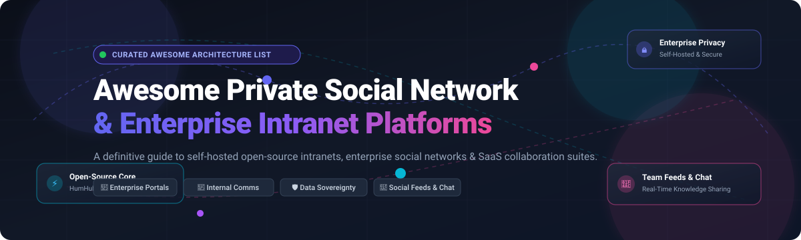

# 🏢 Awesome Private Social Network & Enterprise Intranet

  <strong>Curated directory of top-tier private social networks, modern digital workplace intranets, self-hosted community portals, and team collaboration platforms.</strong>

  
  
  
  
  
  
  

  <a href="#-table-of-contents"><strong>Explore Platforms »</strong></a> •
  <a href="#-sector-overview--market-dynamics"><strong>Market Overview</strong></a> •
  <a href="#-saas--hosted-platforms"><strong>SaaS Suites</strong></a> •
  <a href="#-open-source-software"><strong>Open Source</strong></a> •
  <a href="#-comparison-at-a-glance"><strong>Feature Matrix</strong></a> •
  <a href="#-contributing"><strong>Contribute</strong></a>

---

> 🚀 **SEO & Architectural Highlights**: A comprehensive, unbiased catalog comparing **Enterprise Social Networks (ESN)**, **Private Social Intranets**, **Internal Communications Platforms**, and **Self-Hosted Community Software**. Built for CTOs, IT administrators, HR technology leaders, and DevOps architects seeking alternatives to Microsoft Viva Engage, Workplace from Meta (shutting down), Slack, and SharePoint.
>
> 🌟 *Star this repository to bookmark the latest tools and market analyses for digital workplace architecture!* 🌟

---

## 📋 Table of Contents

- [🌐 Sector Overview & Market Dynamics](#-sector-overview--market-dynamics)
- [🟦 SaaS / Hosted Platforms](#-saas--hosted-platforms)
- [🟩 Open-Source Software](#-open-source-software)
  - [🐘 Mastodon](#-mastodon)
  - [💬 Discourse](#-discourse)
  - [🚀 Rocket.Chat](#-rocketchat)
  - [📝 Outline](#-outline)
  - [🛡️ Mattermost](#-mattermost)
  - [☁️ Nextcloud Hub](#-nextcloud-hub)
  - [⚡ Zulip](#-zulip)
  - [💡 NodeBB](#-nodebb)
  - [👥 HumHub](#-humhub)
  - [🏛️ Liferay Community Edition](#-liferay-community-edition)
  - [🧩 Elgg](#-elgg)
  - [🤝 Open Social](#-open-social)
  - [🏢 eXo Platform](#-exo-platform)
- [📊 Comparison at a Glance](#-comparison-at-a-glance)
- [🤝 Contributing](#-contributing)
- [💖 Support & Sponsorship](#-support--sponsorship)
- [📈 Star History](#-star-history)
- [📄 License](#-license)

---

## 🌐 Sector Overview & Market Dynamics

The global **Social Intranet** and **Enterprise Social Network (ESN)** market is valued at approximately **$7B to $14B** and is projected to expand toward **$25B to $40B+** over the next decade at a 12–18% CAGR, propelled by remote/hybrid digital workplace transformations and asynchronous operational models. 

The sector exhibits a distinct two-tier competitive structure:
* **Concentrated Core (Big-Tech Foundation):** Tech mega-vendors (Microsoft Viva/SharePoint, Salesforce/Slack, Google Workspace) command massive market share by bundling internal social and chat capabilities directly into existing productivity tenant suites.
* **Fragmented Specialization Layer:** The dedicated employee experience and modern intranet layer remains **moderately-to-highly fragmented**. Dozens of agile independent SaaS vendors (Simpplr, LumApps, Interact, Staffbase) and open-core solutions compete aggressively by providing custom engagement analytics, frontline mobile experiences, and specialized editorial news feeds.

---

## 🟦 SaaS / Hosted Platforms

Commercial, cloud-hosted Private Social Network and Intranet platforms. These are proprietary suites included as architectural benchmarks for enterprise feature comparison.

| Platform | Type / Focus | Company Size (Valuation / Revenue) | Starting Tier Pricing | Free Tier / Trial Limits |
|:---|:---|:---|:---|:---|
| **Microsoft Viva Engage** | Enterprise social network within Microsoft 365 | ~$3.1T Market Cap / ~$245B Annual Revenue (Microsoft) | Included in M365 Business Basic ($6.00/user/mo) or E1 ($10.00/user/mo); standalone/advanced Viva Suite at $12.00/user/mo | Core features included free for existing Microsoft 365 / Office 365 tenants; 30-day free trial for premium Viva Suite add-on |
| **Workplace from Meta** | Enterprise social network with feed, chat & groups | ~$1.5T Market Cap / ~$135B Annual Revenue (Meta) | Historically $4.00/user/mo (50% discount to $2.00/user/mo applied during sunset) | Deprecated/Shutting down (June 2026 final shutdown; read-only access mode Sept 2025 – May 2026 at no cost) |
| **LumApps** | Social intranet & employee communication platform | $650M Valuation (Bridgepoint acquisition, 2024) / ~$60M–$70M ARR | ~£2.60–£3.20/user/mo (~$3.30–$4.10/user/mo, G-Cloud baseline) or ~$8.00/user/mo entry tier | No self-service free tier or self-serve trial; custom guided proof-of-concept / demo upon request |
| **Simpplr** | AI-powered employee experience & intranet platform | ~$547M Valuation / Series D (~$70M raised) | £4.00/user/mo (~$5.10/user/mo, G-Cloud Simpplr One baseline; min. 500-user enterprise tiers) | 14-day free trial (sales-assisted upon qualification; no permanent free tier) |
| **Igloo Software** | Digital workplace & modern intranet platform | ~$30M–$36M Annual Revenue (Acquired by Appspace, 2025) | ~$8.00/user/mo (standard baseline packages typically starting at $599/mo block minimum) | No self-service free tier or trial; guided demo / proof-of-concept upon sales qualification |

---

## 🟩 Open-Source Software

Self-hosted, community-driven Private Social Network, Forum, and Intranet tools that ensure full data ownership, GDPR/HIPAA compliance, and privacy sovereignty. Ranked below in descending order by GitHub community stargazers.

### 🐘 Mastodon 
- **Stack:** Ruby on Rails / Node.js / PostgreSQL / Redis | **License:** AGPL-3.0
- **Overview:** Mastodon is the leading decentralized, microblogging social network platform. For organizations and private networks, Mastodon can be deployed in private/authorized-fetch mode where registrations are invite-only or gated via corporate OAuth/SAML, turning it into an internal corporate microblogging feed akin to Yammer or Twitter.
- **Key Features:** ActivityPub federation (optional/toggleable), granular privacy controls (followers-only posts), native Android/iOS mobile clients, rich media attachments, hashtags, and moderation tooling.
- **Best For:** Organizations wanting an internal corporate microblogging feed, executive broadcast stream, or private enterprise community network.

### 💬 Discourse 
- **Stack:** Ruby on Rails / PostgreSQL / Redis | **License:** GPL-2.0
- **Overview:** Discourse is a modern open-source discussion platform that organizes posts into categories and searchable threads. Positioned as the premier open-source tool for **durable knowledge sharing, internal town halls, and asynchronous team discussions**, it replaces noisy chat or ephemeral feeds with structured, searchable conversations.
- **Key Features:** Dynamic notification stream, comprehensive trust metrics, granular permissions, built-in search with AI summarization plugins, community polls, and single sign-on (SSO) integration.
- **Best For:** Organizations wanting structured long-form discussions, internal company Q&A, and policy/announcement repositories.

### 🚀 Rocket.Chat 
- **Stack:** TypeScript / Node.js / MongoDB | **License:** MIT / Open Core
- **Overview:** Rocket.Chat is a comprehensive open-source team communications hub featuring real-time messaging, audio/video conferencing, channels, omnichannel customer routing, and Matrix federation. It provides private communication channels, team broadcast rooms, and deep compliance features for high-security intranets.
- **Key Features:** End-to-end encryption (E2EE), guest access portals, enterprise directory sync (Active Directory, LDAP), audio/video rooms via Jitsi/WebRTC, and unlimited message auditing.
- **Best For:** Enterprises needing a privacy-first, on-premises collaboration and real-time team communication hub.

### 📝 Outline 
- **Stack:** TypeScript / Node.js / React / PostgreSQL / Redis | **License:** BSL 1.1 / Community
- **Overview:** Outline is a fast, collaborative team knowledge base and intranet wiki. Built for modern teams, it provides markdown-first documentation, real-time co-editing, robust search, and granular access controls for building internal knowledge hubs and company handbooks.
- **Key Features:** Real-time multiplayer collaborative editing, nested document hierarchy, lightning-fast instant search, Slack/Google Workspace/OIDC integrations, and public/private team collections.
- **Best For:** Teams building an internal documentation intranet, company handbook, and centralized operational knowledge base.

### 🛡️ Mattermost 
- **Stack:** Go / React / PostgreSQL | **License:** MIT (Team Edition) / Open Core
- **Overview:** Mattermost is an enterprise-grade secure collaboration platform that combines real-time channels, structured playbooks, and audio calling. Positioned as a self-hosted alternative to Slack and Workplace Chat, it integrates seamlessly into corporate intranets requiring high data sovereignty and private cloud deployment.
- **Key Features:** Channel-based messaging, automated incident playbooks, self-hosted voice calls & screen sharing, granular compliance exports, and enterprise SSO (SAML 2.0).
- **Best For:** Technical and regulated organizations seeking self-hosted team communication with integrated operational playbooks.

### ☁️ Nextcloud Hub 
- **Stack:** PHP / Vue.js / MariaDB / PostgreSQL | **License:** AGPL-3.0
- **Overview:** Nextcloud Hub is a comprehensive self-hosted productivity and intranet suite that unifies file sharing (Nextcloud Files), chat/video calls (Nextcloud Talk), groupware (Mail, Calendar, Contacts), and office document editing into a single digital workplace portal.
- **Key Features:** Universal web dashboard with social activity widgets, internal Circles (user groups), collaborative online document editing (via Collabora or OnlyOffice), federated sharing, and cross-platform apps.
- **Best For:** Organizations needing an all-in-one private cloud intranet combining document storage, calendar, chat, and collaborative office tools.

### ⚡ Zulip 
- **Stack:** Python / Django / TypeScript / PostgreSQL | **License:** Apache-2.0
- **Overview:** Zulip is an open-source team collaboration tool that combines the immediacy of real-time chat with the asynchronous structure of email threading. Every message belongs to a specific topic within a stream, eliminating context switching and keeping conversations focused.
- **Key Features:** Unique stream-and-topic threading model, keyboard-driven navigation, enterprise LDAP/SAML authentication, rich Markdown with LaTeX/code syntax highlighting, and 90+ native integrations.
- **Best For:** Distributed teams and companies seeking structured, topic-threaded communication that prevents information overload.

### 💡 NodeBB 
- **Stack:** Node.js / MongoDB / Redis | **License:** GPL-3.0
- **Overview:** NodeBB is a fast, responsive modern forum engine built with web sockets for real-time interactions, streaming notifications, and mobile readiness. It is widely used to power internal employee communities, knowledge-sharing hubs, and private customer forums.
- **Key Features:** Instant real-time updates via WebSockets, built-in chat, social sharing plugins, rich gamification with badges and reputation scores, and comprehensive REST APIs.
- **Best For:** Teams looking for a modern, real-time community forum with extensive plugin support and seamless SSO.

### 👥 HumHub 
- **Stack:** PHP / Yii2 / MySQL | **License:** AGPL-3.0 (open core)
- **Overview:** HumHub is the premier open-source social intranet platform and the closest analog to Workplace from Meta. It features user profiles, Spaces (groups) with individual walls, a network-wide social activity stream, wikis, tasks, shared calendars, files, and mobile apps. It supports LDAP and SAML for enterprise identity federation.
- **Key Features:** Activity streams (news feed), modular Spaces for departments and project squads, rich marketplace of add-on modules, integrated wiki, task management boards, and mobile push notifications.
- **Best For:** Organizations and member communities wanting a turnkey self-hosted social intranet with a social news feed, team spaces, and internal wikis.

### 🏛️ Liferay Community Edition 
- **Stack:** Java | **License:** LGPL-2.1
- **Overview:** Liferay is an enterprise portal and digital experience platform designed for building complex, multi-site corporate intranets. It features drag-and-drop widget composition, role-based content personalization, document management, forms, and deep enterprise identity integration.
- **Key Features:** Multi-tenant and multi-site architecture, granular role-based access control (RBAC), CMS and workflow engines, modular OSGi-based extensions, and extensive enterprise integration hooks.
- **Best For:** Large enterprise organizations needing a highly customizable, portal-based corporate intranet with granular delegated administration.

### 🧩 Elgg 
- **Stack:** PHP / MySQL | **License:** GPL-2.0 / MIT
- **Overview:** Elgg is a flexible open-source social engine framework built on an entity-relationship data model. Everything from blogs and activity feeds to user groups is handled via its modular plugin architecture, enabling developers to build bespoke social networking platforms.
- **Key Features:** Granular entity access control, event-driven architecture, modular plugin ecosystem, user profile fields customization, and flexible relationship graphs.
- **Best For:** Developers and technical teams wanting to architect a custom internal social network from an extensible engine.

### 🤝 Open Social 
- **Stack:** PHP / Drupal | **License:** GPL-2.0 (open core)
- **Overview:** Open Social is a community and intranet distribution built on Drupal. Designed as an alternative to Facebook Groups and Workplace, it provides social activity feeds, group management, event coordination, and discussion modules, leveraging Drupal's rich content-management ecosystem.
- **Key Features:** Deep Drupal taxonomy and content modeling, event management with calendar integrations, member directories, and enterprise compliance modules.
- **Best For:** Organizations already using Drupal or seeking a community intranet with robust content modeling.

### 🏢 eXo Platform 
- **Stack:** Java | **License:** AGPL-3.0 (Community Edition)
- **Overview:** eXo Platform is an open-source digital workplace solution combining enterprise social networking, team collaboration spaces, document management, wikis, task boards, and gamification rewards in a unified web portal.
- **Key Features:** Collaborative Spaces, activity streams, document content management (DCM), gamification engine with recognition badges, and integrated task calendars.
- **Best For:** Mid-market to enterprise companies looking for an all-in-one digital workplace and social collaboration suite.

---

## 📊 Comparison at a Glance

| Software | License | Stack | Social Feed | Spaces/Groups | Real-Time Chat | Self-Hosted | Best Use Case |
|:---|:---|:---|:---:|:---:|:---:|:---:|:---|
| **Viva Engage** | Proprietary | Cloud | ✅ | ✅ Communities | (Teams) | ❌ | Microsoft 365 enterprises |
| **Workplace** | Proprietary | Cloud | ✅ | ✅ Groups | ✅ | ❌ | (Shutting down / migration required) |
| **LumApps** | Proprietary | Cloud | ✅ | ✅ Communities | ❌ | ❌ | Google Workspace / M365 digital intranet |
| **Simpplr** | Proprietary | Cloud | ✅ | ✅ Sites | ❌ | ❌ | AI-powered employee experience & news |
| **Igloo Software**| Proprietary | Cloud | ✅ | ✅ Spaces | ❌ | ❌ | Out-of-the-box corporate digital workplace |
| **Mastodon** | AGPL-3.0 | Ruby/Rails | ✅ | ❌ (Hashtags) | ❌ | ✅ | Private corporate microblogging feed |
| **Discourse** | GPL-2.0 | Ruby/Rails | ❌ (Forum) | ✅ Categories | ❌ | ✅ | Structured discussion & searchable Q&A |
| **Rocket.Chat** | MIT / Open Core | TS/Node | ❌ | ✅ Channels | ✅ | ✅ | Privacy-first team communication hub |
| **Outline** | BSL 1.1 / Open | TS/Node | ❌ | ✅ Collections | ❌ | ✅ | Modern team knowledge base & intranet wiki |
| **Mattermost** | MIT / Open Core | Go/Postgres | ❌ | ✅ Channels | ✅ | ✅ | Self-hosted secure team chat & playbooks |
| **Nextcloud Hub**| AGPL-3.0 | PHP/Vue | ✅ (Activity) | ✅ Circles | ✅ (Talk) | ✅ | All-in-one private cloud intranet suite |
| **Zulip** | Apache-2.0 | Python/Django | ❌ | ✅ Streams | ✅ (Threaded) | ✅ | Asynchronous topic-threaded team chat |
| **NodeBB** | GPL-3.0 | Node.js | ❌ | ✅ Categories | ❌ | ✅ | Real-time community discussion forum |
| **HumHub** | AGPL-3.0 | PHP/Yii2 | ✅ | ✅ Spaces | ❌ (Not chat) | ✅ | Social intranet + team spaces & walls |
| **Liferay CE** | LGPL-2.1 | Java | (Portlets) | ✅ Sites | ❌ | ✅ | Multi-site enterprise portal intranet |
| **Elgg** | GPL-2.0 / MIT | PHP/MySQL | ✅ (Custom) | ✅ (Plugins) | ❌ | ✅ | Bespoke developer-built social networks |
| **Open Social** | GPL-2.0 | PHP/Drupal | ✅ | ✅ Groups | ❌ | ✅ | Drupal-based community & member platform |
| **eXo Platform**| AGPL-3.0 | Java | ✅ | ✅ Spaces | (Chat) | ✅ | Digital workplace & employee portal |

---

## 🤝 Contributing

Contributions, software suggestions, and documentation improvements are welcome! If you know of a remarkable open-source Private Social Network or Intranet tool that should be included:

1. 🍴 Fork the repository.
2. 🌿 Create a feature branch (`git checkout -b feature/new-intranet-tool`).
3. 📝 Add your entry with project name, URL, stack, license, and distinguishing capabilities.
4. 💾 Commit your changes (`git commit -m 'feat: add CoolPlatform'`).
5. 🚀 Push to the branch (`git push origin feature/new-intranet-tool`).
6. 📬 Open a Pull Request.

Please ensure the software project is actively maintained (releases within the last 12 months) and adheres to open-source licensing standards.

---

## 💖 Support & Sponsorship

Thank you for exploring and utilizing this curated architecture guide! 

Maintaining and continuously benchmarking open-source and enterprise collaboration ecosystems takes ongoing research and testing. If this repository saved you research time, assisted your company's digital workplace migration, or proved useful to your engineering stack:

- ⭐ **Star this repository** to help others discover it.
- 🍴 **Fork and share** with colleagues and teams architecting internal platforms.
- ☕ **Support development & sponsor ongoing work**:
  - [**Sponsor on GitHub Sponsor Dashboard**](https://github.com/sponsors/ishandutta2007)

Every contribution and star fuels further benchmarking and maintenance!

---

## 📈 Star History

---

## 📄 License

This repository and curated list are released under the [Creative Commons Zero v1.0 Universal](https://creativecommons.org/publicdomain/zero/1.0/) (CC0 1.0 - Public Domain Dedication). All linked software projects, logos, and trademarks retain their respective owners' copyrights and licenses.
